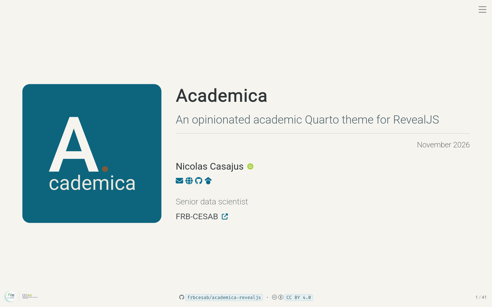
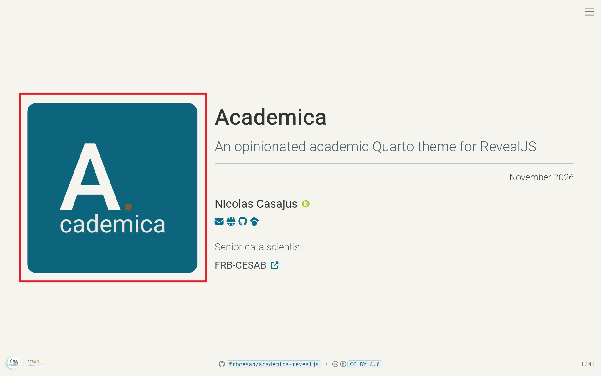
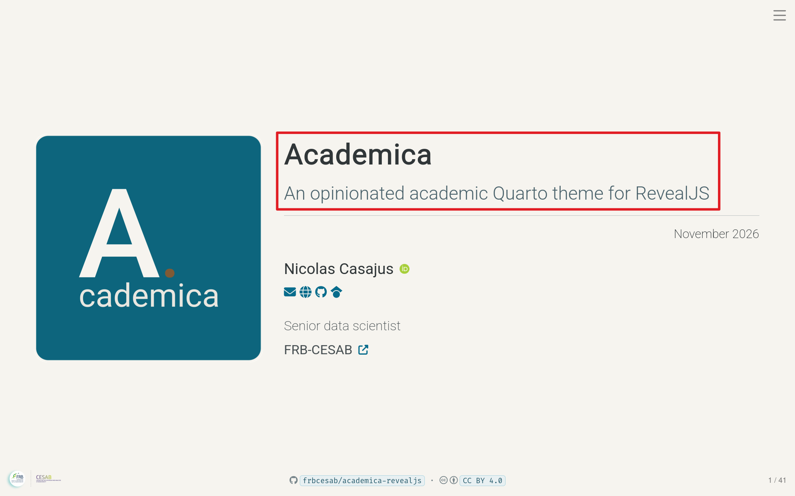
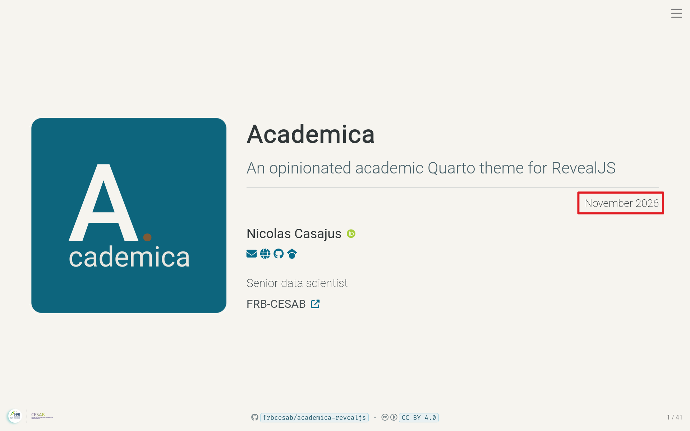
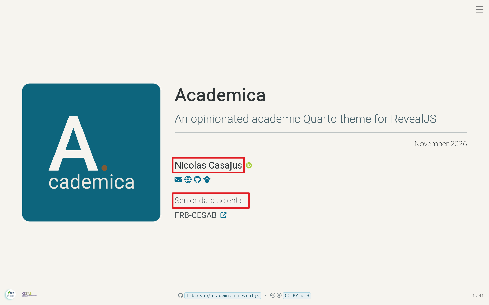
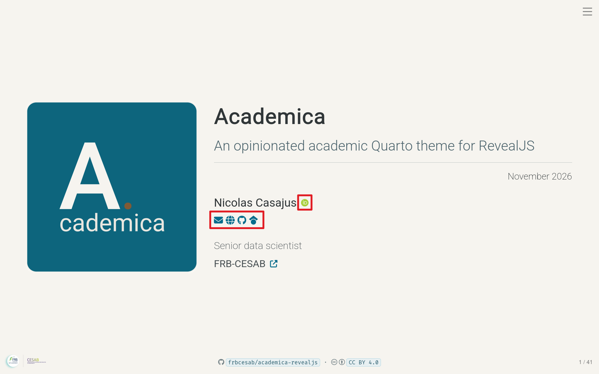
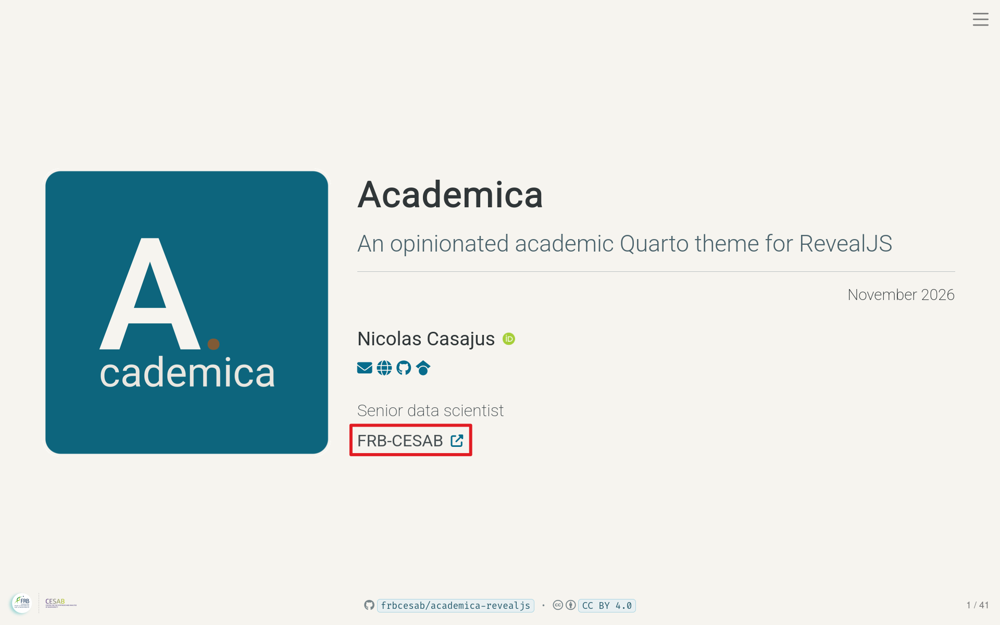
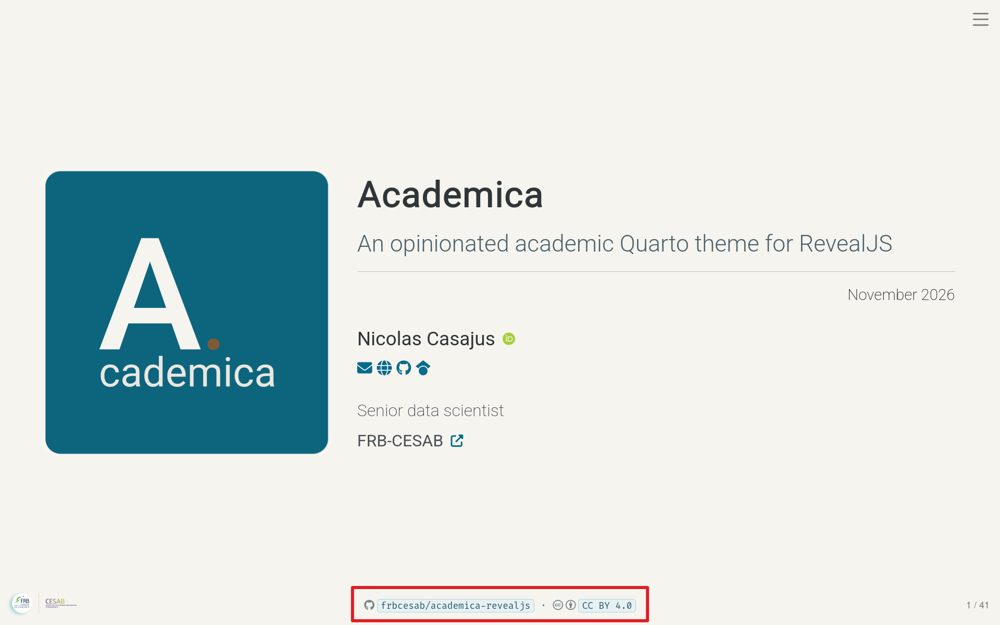
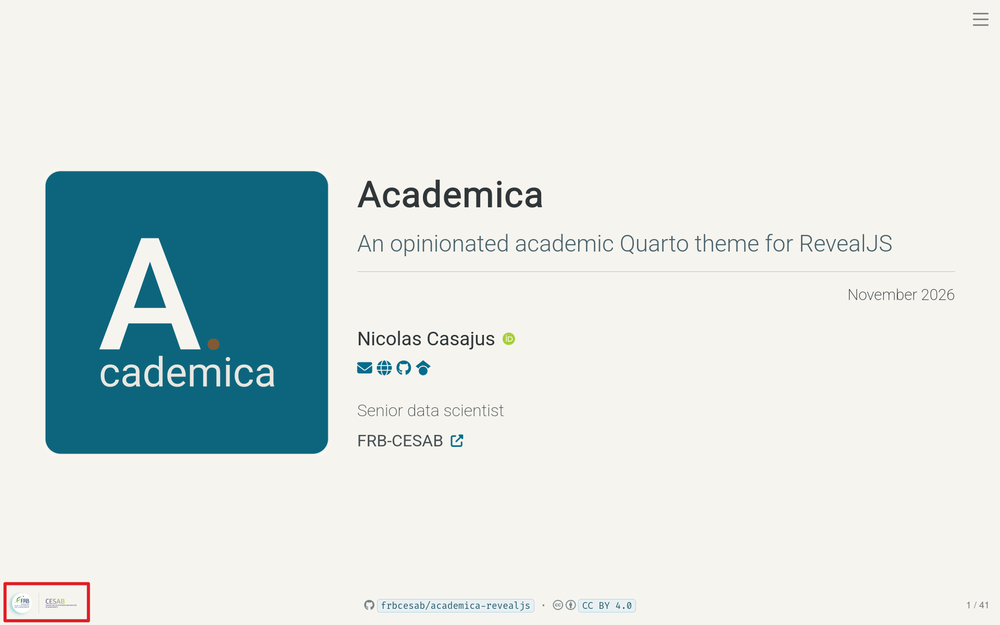
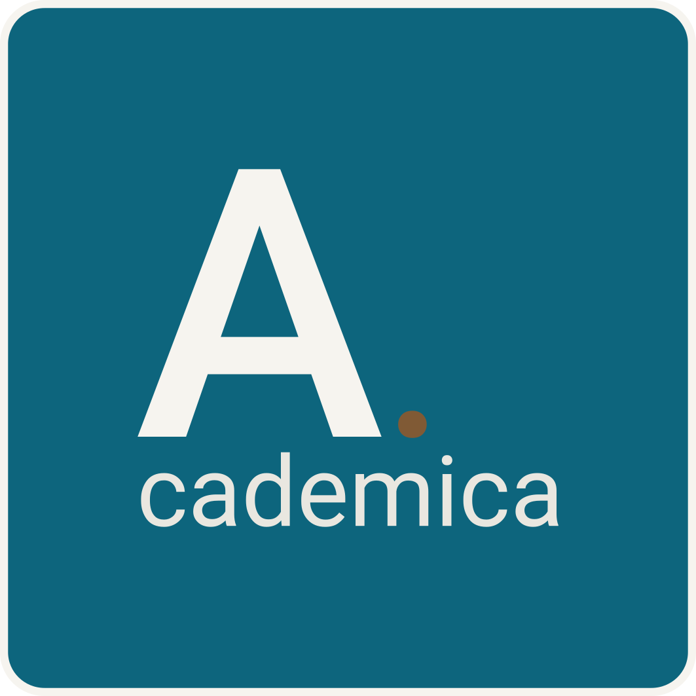

# Getting started


## Getting started

::: {.size-sm}
**Academica** is a [Quarto](https://quarto.org) extension built on RevealJS, 
providing a consistent visual identity and opinionated defaults for academic 
presentations.

[]{.vspace-2xs}

::: {.grid .g-gap-4}

::: {.g-col-6}

**Start from the template (new project)**

```bash
quarto use template frbcesab/academica-revealjs
```

:::

::: {.g-col-6}

**Or, add the extension to an existing project**

```bash
quarto add frbcesab/academica-revealjs
```

[]{.vspace-2xs}

Then use it in the YAML of your `.qmd` file:

```yaml
format: academica-revealjs
```
:::
:::
:::


> Casajus N (2026) _**Academica:** An opinionated academic Quarto theme for RevealJS_.<br>
URL: <https://github.com/frbcesab/academica-revealjs>.


# Theme overview


## Color palette

The **Academica** theme uses the following color palette:

<br>

<div class="color-palette">

<div class="color-item">
<div class="color-square" style="background-color: #0D657D;"></div>
<div class="color-label">Primary</div>
<div class="color-hex">#0D657D</div>
</div>

<div class="color-item">
<div class="color-square" style="background-color: #4A626B;"></div>
<div class="color-label">Secondary</div>
<div class="color-hex">#4A626B</div>
</div>

<div class="color-item">
<div class="color-square" style="background-color: #805A35;"></div>
<div class="color-label">Accent</div>
<div class="color-hex">#805A35</div>
</div>

<div class="color-item">
<div class="color-square" style="background-color: #303638;"></div>
<div class="color-label">Text</div>
<div class="color-hex">#303638</div>
</div>

<div class="color-item">
<div class="color-square" style="background-color: #F6F4EF;"></div>
<div class="color-label">Background</div>
<div class="color-hex">#F6F4EF</div>
</div>

<div class="color-item">
<div class="color-square" style="background-color: #E9E7E0;"></div>
<div class="color-label">Surface</div>
<div class="color-hex">#E9E7E0</div>
</div>

</div>

<br>

::: {.size-xs}
&nbsp;
Designed with visual accessibility in mind, supporting users with color vision 
deficiencies, low vision, and reduced contrast sensitivity.
:::


## Font families {#font-families}


::: {.grid}

::: {.g-col-5}

### Roboto


::: {.size-md}
The primary typeface for headings and body text.
:::

::: {.size-sm}
Available on Google Fonts [](https://fonts.google.com/specimen/Roboto)
:::

:::

::: {.g-col-1}
:::

::: {.g-col-6 .g-cell style='background-color: #E9E7E0;border:0;'}

::: {.font-showcase .roboto}
Aa Bb Cc Dc Ee Ff<br>
ABCDEFGHIJKLMNOPQRSTUVWXYZ<br>
0123456789
:::

:::

:::


[]{.vspace-md}

:::: {.grid}

::: {.g-col-5}

### Fira Code

::: {.size-md}
A monospaced typeface with ligatures for code.
:::

::: {.size-sm}
Available on Google Fonts [](https://fonts.google.com/specimen/Fira+Code)
:::
:::

::: {.g-col-1}
:::

::: {.g-col-6 .g-cell style='background-color: #E9E7E0;border:0;'}

::: {.size-xl .font-showcase .fira-code}
```
if (nrow(tab) >= 0) tab |> head()
ABCDEFGHIJKLMNOPQRSTUVWXYZ
0123456789
```
:::

:::

::::


# Opening slide

## Opening slide

{.box-shadow fig-align='center' width=80%}


## Image

::: {.grid}

::: {.g-col-7}
{.box-shadow width=100%}

:::

::: {.g-col-5 .size-sm}

[]{.vspace-sm}

Use the YAML parameter:

- `image`

[]{.vspace-xs}

```{.yaml}
image: assets/logo-title.png
```
:::

:::


## Title and subtitle

::: {.grid}

::: {.g-col-7}
{.box-shadow width=100%}
:::

::: {.g-col-5 .size-sm}

[]{.vspace-sm}

Use the YAML parameters:

- `title`
- `subtitle`

[]{.vspace-xs}

```{.yaml}
title: "Petrol & Linen"
subtitle: "An opinionated academic..."
```
:::

:::

## Date

::: {.grid}

::: {.g-col-7}
{.box-shadow width=100%}
:::

::: {.g-col-5 .size-sm}

[]{.vspace-sm}

Use the YAML parameters:

- `date`
- `date-format`

[]{.vspace-xs}

```{.yaml}
format:
  academica-revealjs:
    date: today
    date-format: "MMMM YYYY"
```
:::

:::


[]{.vspace-xs}

::: {.size-xs}
&nbsp;
More information on how to format dates in Quarto [](https://quarto.org/docs/reference/dates.html)
:::


## Authors

::: {.grid}

::: {.g-col-7}
{.box-shadow width=100%}
:::

::: {.g-col-5 .size-sm}

[]{.vspace-sm}

Use the YAML parameters:

- `authors`
- `name`
- `role`

[]{.vspace-xs}

```{.yaml}
authors:
  - name: "Nicolas Casajus"
    role: "Senior data scientist"
```
:::

:::

[]{.vspace-xs}

::: {.size-xs}
&nbsp;
This theme supports **up to three** authors.
:::


## Socials

::: {.grid}

::: {.g-col-7}
{.box-shadow width=100%}
:::

::: {.g-col-5 .size-sm}

[]{.vspace-sm}

Use the YAML parameters:

- `authors`
- `socials`

[]{.vspace-xs}

```{.yaml}
authors:
  - name: "Nicolas Casajus"
    socials:
      email: "mail@example.org"
      orcid: "..."
```
:::

:::

[]{.vspace-xs}

::: {.size-xs}
&nbsp;
This theme only supports icons for: **ORCID**, **Email**, **Website**, **GitHub**, **Google Scholar**.
:::


## Author affiliation

::: {.grid}

::: {.g-col-7}
{.box-shadow width=100%}
:::

::: {.g-col-5 .size-sm}

[]{.vspace-sm}

Use the YAML parameters:

- `authors`
- `affiliations`

[]{.vspace-xs}

```{.yaml}
authors:
  - name: "Nicolas Casajus"
    affiliations:
      - name: "FRB-CESAB"
        website: "https://..."
```
:::

:::

[]{.vspace-xs}

::: {.size-xs}
&nbsp;
This theme supports **many affiliations** per author.
:::

# Footer


## Footer

::: {.grid}

::: {.g-col-7}
{.box-shadow width=100%}

:::

::: {.g-col-5 .size-sm}

[]{.vspace-sm}

Use the YAML parameter:

- `footer`

[]{.vspace-xs}

```{.yaml}
footer: This is a footer
```
:::

:::


## Logo

::: {.grid}

::: {.g-col-7}
{.box-shadow width=100%}

:::

::: {.g-col-5 .size-sm}

[]{.vspace-sm}

Use the YAML parameter:

- `logo`

[]{.vspace-xs}

```{.yaml}
format:
  academica-revealjs:
    logo: assets/logo-brand.png
```
:::

:::


# Typography

## Markdown basics

:::: {.columns .size-sm}
::: {.column width="50%"}

#### Text formatting

A regular paragraph with normal, **bold**, _italic_, ~~strikethrough~~ and `inline code`.

[]{.vspace-2xs}

#### Lists

:::: {.columns}
::: {.column}
- Unordered item
- Another item
:::

::: {.column}
1. Numbered item
1. Another item
:::
::::

[]{.vspace-2xs}

#### Links

- <https://quarto.org>
- [Quarto documentation](https://quarto.org)
- Quarto documentation [](https://quarto.org/)

:::

::: {.column width=10%}
:::

::: {.column width=40% .size-xs}

| Element        | Syntax             |
|:------------|:----------------------|
| Header 1       | `# Header`         |
| Header 4       | `#### Header`      |
| Bold           | `**bold**`         |
| Italic         | `*italic*`         |
| Strikethrough  | `~~text~~`         |
| Inline code    |`code`              |
| Unordered list | `- item`           |
| Numbered list  | `1. item`          |
| Image          | `` |
| Link           | `[text](url)`      |
| Link           | `<url>`            |

:::

::::

## CSS classes: styling your content

::: {.size-sm}
Quarto allows you to apply **CSS classes** to Markdown elements using `div` and `span`.

[]{.vspace-2xs}

#### Block-level styling — `div`

Use a fenced `div` to apply a CSS class to a **block of content**.

::: {.width-66}

```{.md}
::: {.size-xs}
This entire block receives the `size-xs` style.

You can include paragraphs, lists, and other Markdown elements.
:::
```
:::

[]{.vspace-sm}

#### Inline styling — `span`

Use a `span` to apply a CSS class to a **portion of text**.

::: {.width-66}

```{.md}
This is a [special phrase]{.size-xl} inside a paragraph.
```
:::

:::

## Text emphasis

You can **highlight some text** using the following CSS classes:

::: {.vspace-sm}
:::

::: {.size-sm}

:::: {.columns}
::: {.column}

- The `.bg-*` classes

::: {.size-sm}
| Class | Output |
|:------|:-------|
| `.bg` or `.bg-note` | One [important]{.bg-note} detail      |
| `.bg-tip`           | One [important]{.bg-tip} detail       |
| `.bg-important`     | One [important]{.bg-important} detail |
:::
:::

::: {.column}

- The `.fg-*` classes

::: {.size-sm}
| Class | Output |
|:------|:-------|
| `.fg` or `.fg-note` | One [important]{.fg-note} detail      |
| `.fg-tip`           | One [important]{.fg-tip} detail       |
| `.fg-important`     | One [important]{.fg-important} detail |
:::
:::
::::

:::

## Font sizing

Use the following CSS classes to **customize the font size** of any element 


[]{.vspace-xs}

::: {.grid}

::: {.g-col-4 .g-cell}
`.size-lg` (1.125em)

[**Large**]{.size-lg} text
:::

::: {.g-col-4 .g-cell}
`.size-xl` (1.25em)

[**Very large**]{.size-xl} text
:::

::: {.g-col-4 .g-cell}
`.size-2xl` (1.50em)

[**Extra large**]{.size-2xl} text
:::

::: {.g-col-4 .g-cell}
`.size-sm` (0.875em)

[**Small**]{.size-sm} text
:::

::: {.g-col-4 .g-cell}
`.size-xs` (0.75em)

[**Very small**]{.size-xs} text
:::

::: {.g-col-4 .g-cell}
`.size-2xs` (0.60em)

[**Extra small**]{.size-2xs} text
:::

:::

::: {.vspace-md}
:::

::: {.size-xs}
&nbsp; Works with slide, div, span, paragraph, 
list, blockquote, table, code block and grid!
:::


## Text alignment


Use the CSS classes `.text-center` & `.text-right` to 
**horizontally align** text

::: {.vspace-sm}
:::

::: {.text-center}
This text is centered.
:::

::: {.text-right}
This text is aligned to the right.
:::


[]{.vspace-sm}

```{.md}
::: {.text-center}
This text is centered.
:::

::: {.text-right}
This text is aligned to the right.
:::
```


# Components

## Block quotes

> A robot may not injure a human being, or, through inaction, 
> allow a human being to come to harm.
>
> [Isaac Asimov]{.quote-author}
> [I, Robot · 1950 (The First Law of Robotics)]{.quote-source}


::: {.vspace-md}
:::

::: {.size-sm}
This theme implements two CSS classes: `.quote-author` and `.quote-source`
:::

::: {.vspace-sm}
:::

::: {.width-75}
```{.md}
> A robot may not injure a human being, or, through inaction, 
> allow a human being to come to harm.
>
> [Isaac Asimov]{.quote-author}
> [I, Robot · 1950 (The First Law of Robotics)]{.quote-source}
```
:::

## Callout blocks

:::: {.columns}

::: {.column width=50%}
:::{.callout-tip}
## Tip

Use this code to create a callout block:

```{.quarto}
:::{.callout-tip}
## Tip

Use this code to create a callout block:
:::
```

:::
:::

::: {.column width=50%}
:::{.callout-note}
## Note

Use this code to create a callout block:

```{.quarto}
:::{.callout-note}
## Note

Use this code to create a callout block:
:::
```
:::
:::

::::

:::: {.columns}

::: {.column width=50%}
:::{.callout-important}
## Important

Use this code to create a callout block:

```{.quarto}
:::{.callout-important}
## Important

Use this code to create a callout block:
:::
```
:::
:::

::: {.column width=50%}
:::{.callout-caution}
## Caution

Use this code to create a callout block:

```{.quarto}
:::{.callout-caution}
## Caution

Use this code to create a callout block:
:::
```
:::
:::

::::


## Tables

::: {.grid}

::: {.g-col-6 .width-75}

```{.md}
|  Col  | Description    |
| :---: | :------------- |
|   1   | Lorem ipsum    |
|   2   | Lorem ipsum    |
```

:::

::: {.g-col-6}

|  Col  | Description    |
| :---: | :------------- |
|   1   | Lorem ipsum    |
|   2   | Lorem ipsum    |

:::

::: {.g-col-6 .width-75}

```{.md}
::: {.size-xs}
|  Col  | Description    |
| :---: | :------------- |
|   1   | Lorem ipsum    |
|   2   | Lorem ipsum    |
:::
```
:::

::: {.g-col-6 .size-xs}

|  Col  | Description    |
| :---: | :------------- |
|   1   | Lorem ipsum    |
|   2   | Lorem ipsum    |

:::


::: {.g-col-6 .width-75}

```{.md}
::: {.full-width-table}
|  Col  | Description    |
| :---: | :------------- |
|   1   | Lorem ipsum    |
|   2   | Lorem ipsum    |
:::
```
:::

::: {.g-col-6 .size-xs .full-width-table}

|  Col  | Description    |
| :---: | :------------- |
|   1   | Lorem ipsum    |
|   2   | Lorem ipsum    |

:::

:::


## Images

::: {.grid}

::: {.g-col-4 .g-cell}
{fig-align="left" width=50%}
:::

::: {.g-col-4 .g-cell}
{fig-align="center" width=50%}
:::

::: {.g-col-4 .g-cell}
{fig-align="right" width=50%}
:::
:::

[]{.vspace-md}

::: {.width-75}

```{.md}
{fig-align="left" width=50%}
```
:::

[]{.vspace-sm}

::: {.size-xs}
&nbsp; Caption alignment will follow image alignment
:::


# Layouts


## Multi-column layouts

Disposition en deux ou plusieurs colonnes


## Grid layouts

::: {.grid .g-justify-center .text-center}

::: {.g-col-6 .g-cell}
`.g-col-6`
:::

::: {.g-col-6 .g-cell}
`.g-col-6`
:::


::: {.g-col-4 .g-cell}
`.g-col-4`
:::

::: {.g-col-4 .g-cell}
`.g-col-4`
:::

::: {.g-col-4 .g-cell}
`.g-col-4`
:::

::: {.g-col-2 .g-cell}
`.g-col-2`
:::

::: {.g-col-8 .g-cell}
`.g-col-8`
:::

::: {.g-col-2 .g-cell}
`.g-col-2`
:::

::: {.g-col-3 .g-cell}
`.g-col-3`
:::

::: {.g-col-3 .g-cell}
`.g-col-3`
:::

::: {.g-col-3 .g-cell}
`.g-col-3`
:::

::: {.g-col-3 .g-cell}
`.g-col-3`
:::

::: {.g-col-2 .g-cell}
`.g-col-2`
:::

::: {.g-col-2 .g-cell}
`.g-col-2`
:::

::: {.g-col-2 .g-cell}
`.g-col-2`
:::

::: {.g-col-2 .g-cell}
`.g-col-2`
:::

::: {.g-col-2 .g-cell}
`.g-col-2`
:::

::: {.g-col-2 .g-cell}
`.g-col-2`
:::

:::

## Element width

Use the CSS classes `.width-*` to **reduce the width** of any element

::: {.vspace-sm}
:::

```{.md}
A paragraph
```

::: {.width-75}
```{.md}
::: {.width-75}
A paragraph
:::
```
:::


::: {.width-50}
```{.md}
::: {.width-50}
A paragraph
:::
```
:::

::: {.width-25}
```{.md}
::: {.width-25}
A paragraph
:::
```
:::

[]{.vspace-2xs}

::: {.size-xs}
&nbsp; Available width are: `.width-25` `.width-33`
`.width-50` `.width-66` `.width-75`
:::


## Horizontal positioning

::: {.left .width-33}
```{.md}
::: {.left .width-33}
Left block
:::
```
:::

::: {.center .width-33}
```{.md}
::: {.center .width-33}
Central block
:::
```
:::


::: {.right .width-33}
```{.md}
::: {.right .width-33}
Right block
:::
```
:::


## Vertical spacing


# Class reference

## Class reference {.full-width-table}

::: {.grid .size-2xs .g-gap-3}

::: {.g-col-4 .no-border}

|                |
| :------------- |
| `.left`        |
| `.center`      |
| `.right`       |
| `.middle`      |
| `.text-left`   |
| `.text-center` |
| `.text-right`  |
| `.size-2xs`    |
| `.size-xs`     |
| `.size-sm`     |
| `.size-lg`     |
| `.size-xl`     |
| `.size-2xl`    |

:::

::: {.g-col-4 .no-border}

|               |
| :------------ |
| `.width-25`   |
| `.width-33`   |
| `.width-50 `  |
| `.width-66 `  |
| `.width-75`   |
| `.vspace-2xs` |
| `.vspace-xs ` |
| `.vspace-sm ` |
| `.vspace-md ` |
| `.vspace-lg ` |
| `.vspace-xl ` |
| `.vspace-2xl` |
| `.box-shadow` |
:::

::: {.g-col-4 .no-border}

|                     |
| :------------------ |
| `.bg` &nbsp; `.bg-note` |
| `.bg-tip`           |
| `.bg-important`     |
| `.fg` &nbsp; `.fg-note` |
| `.fg-tip`           |
| `.fg-important`     |
| `.quote-author`     |
| `.quote-source`     |
| `.full-width-table` |
| `.grid`             |
| `.g-col-*`          |
| `.g-gap-*`          |

:::
:::


# Extra

## Fontawesome icons

Instructions...


## Fontawesome icons {.full-width-table}

::: {.grid .size-2xs}

::: {.g-col-4}

| Label               | Icon                                 |
|:----------------|:----:|
| `code`              |               |
| `terminal`          |           |
| `brands git-alt`    |     |
| `brands github`     |      |
| `brands gitlab`     |      |
| `code-commit`       |        |
| `code-fork`         |          |
| `code-branch`       |        |
| `code-compare`      |       |
| `code-merge`        |         |
| `code-pull-request` |  |

:::

::: {.g-col-4}

| Label                   | Icon                                     |
|:----------------|:----:|
| `brands orcid`          |           |
| `brands google-scholar` |  |
| `brands facebook`       |        |
| `brands linkedin`       |        |
| `brands instagram`      |       |
| `brands x-twitter`      |       |
| `brands mastodon`       |        |
| `brands telegram`       |        |
| `brands youtube`        |         |
| `brands discord`        |         |
| `brands twitch`         |          |

:::

::: {.g-col-4}
| Label            | Icon                              |
|:----------------|:----:|
| `brands apple`   |    |
| `brands windows` |  |
| `brands linux`   |    |
| `brands debian`  |   |
| `brands fedora`  |   |
| `brands redhat`  |   |
| `brands ubuntu`  |   |
| `brands chrome`  |   |
| `brands edge`    |     |
| `brands firefox` |  |
| `brands safari`  |   |
:::

:::

## Fontawesome icons {.full-width-table}

::: {.grid .size-2xs}

::: {.g-col-4}

| Label              | Icon                                |
|:----------------|:----:|
| `brands python`    |     |
| `brands r-project` |  |
| `brands markdown`  |   |
| `brands html5`     |      |
| `brands css3-alt`  |   |
| `brands js`        |         |
| `brands rust`      |       |
| `brands golang`    |     |
| `brands php`       |        |
| `brands sass`      |       |
| `brands docker`    |     |

:::

::: {.g-col-4}

| Label                  | Icon                                    |
|:----------------|:----:|
| `arrow-right`          |           |
| `right-long`           |            |
| `circle-arrow-right`   |    |
| `circle-right`         |          |
| `circle-chevron-right` |  |
| `right-to-bracket`     |      |
| `right-from-bracket`   |    |
| `left-right`           |            |
| `right-left`           |            |
| `arrow-rotate-right`   |    |
| `up-right-from-square` |  |

:::

::: {.g-col-4}

| Label                  | Icon                                    |
|:----------------|:----:|
| `check`                |                 |
| `xmark`                |                 |
| `circle-check`         |          |
| `circle-xmark`         |          |
| `circle-exclamation`   |    |
| `triangle-exclamation` |  |
| `circle-question`      |       |
| `circle-info`          |           |
| `lightbulb`            |             |
| `square`               |                |
| `circle`               |                |

:::

:::


## Fontawesome icons {.full-width-table}

::: {.grid .size-2xs}

::: {.g-col-4}

| Label                  | Icon                                            |
|:----------------|:----:|
| `stamp`                |                         |
| `file-signature`       |                |
| `certificate`          |                   |
| `award`                |                         |
| `copyright`            |                     |
| `creative-commons`     |       |
| `creative-commons-zero`|  |
| `creative-commons-by`  |    |
| `creative-commons-nc`  |    |
| `creative-commons-nd`  |    |
| `creative-commons-sa`  |    |


:::

::: {.g-col-4}

| Label                 | Icon                                   |
|:----------------|:----:|
| `user`                |                 |
| `users`               |                |
| `user-group`          |           |
| `users-line`          |           |
| `users-between-lines` |  |
| `envelope`            |             |
| `paper-plane`         |          |
| `globe`               |                |
| `clock`               |                |
| `lock`                |                 |
| `lock-open`           |            |


:::

::: {.g-col-4}

| Label         | Icon                           |
|:----------------|:----:|
| `house`       |        |
| `wrench`      |       |
| `table`       |        |
| `file`        |         |
| `file-pen`    |     |
| `file-lines`  |   |
| `book-open`   |    |
| `layer-group` |  |
| `database`    |     |
| `image`       |        |
| `cube`        |         |

:::
:::

